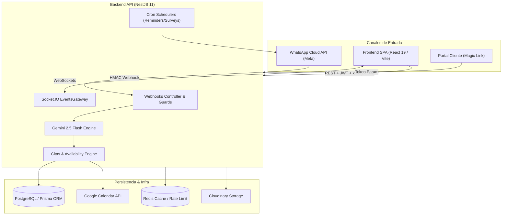

# 🛡️ Auditoría Exhaustiva de Producción — Wavio Platform

> [!IMPORTANT]
> **Resumen Ejecutivo**: La plataforma cuenta con una arquitectura base sólida (NestJS modular en backend, Clean Architecture con Container/Presentational en React 19, TypeScript estricto y suites de pruebas unitarias extensas). Sin embargo, se detectaron **7 defectos críticos de runtime y concurrencia**, fallas de diseño en la integración de IA con WhatsApp y deuda de migración de base de datos que representan un riesgo severo para un entorno de producción activo.

---

## 🗺️ Mapa de Arquitectura y Superficie Auditada



---

## 🔴 Hallazgos Críticos (Bloqueantes de Producción)

### 1. Condición de Carrera en Agendamiento (Doble Reserva Concurrente)

- **Archivo afectado**: [`citas.repository.ts`](file:///home/svfabio/Projects/01-wavio/ai-appointment-platform-backend/src/citas/citas.repository.ts#L104-L122) y [`schema.prisma`](file:///home/svfabio/Projects/01-wavio/ai-appointment-platform-backend/prisma/schema.prisma#L205-L242).
- **Causa Raíz**:
  `createIfSlotAvailable` ejecuta una transacción interactiva de Prisma con nivel de aislamiento por defecto (`Read Committed` en PostgreSQL). El método realiza un `findFirst` de verificación y luego un `create`. En PostgreSQL, un `SELECT` (findFirst) **no adquiere bloqueos de lectura ni de fila**. Si dos solicitudes para el mismo horario y negocio ingresan en paralelo (dos clientes por WhatsApp o un admin y un cliente), ambas leen que el horario está libre y ambas insertan.
  En [`schema.prisma`](file:///home/svfabio/Projects/01-wavio/ai-appointment-platform-backend/prisma/schema.prisma#L240), el modelo `Cita` tiene índices no únicos: `@@index([negocioId, fecha, estado])`. **No existe una restricción `UNIQUE (negocioId, staffId, fecha, horario)`**.
- **Impacto**: Dos clientes reciben confirmación para el mismo turno con el mismo profesional al mismo tiempo.
- **Solución Recomendada**:
  1. Agregar un índice único o exclusión parcial en PostgreSQL/Prisma para citas no canceladas:
     ```prisma
     // Unique compuesto para evitar reservas concurrentes
     @@unique([negocioId, staffId, fecha, horario])
     ```
  2. En el repositorio, usar un raw query con `SELECT ... FOR UPDATE` o capturar el error `P2002` (Unique constraint failed) de Prisma para retornar `null`.

---

### 2. Ruptura del Flujo de Agendamiento en la IA de WhatsApp (Gemini Tool Calling)

- **Archivo afectado**: [`ai-engine.ts`](file:///home/svfabio/Projects/01-wavio/ai-appointment-platform-backend/src/chat/ai-engine.ts#L186-L240) y [`webhook.service.ts`](file:///home/svfabio/Projects/01-wavio/ai-appointment-platform-backend/src/webhooks/webhook.service.ts#L227-L255).
- **Causa Raíz**:
  En `procesarMensajeConIA`, cuando Gemini decide ejecutar la herramienta `agendar_cita`, el backend ejecuta la función mediante el callback `ejecutarHerramienta` y envía el `functionResponse` de vuelta al modelo (`followUp`).
  Gemini responde al `functionResponse` con texto conversacional natural (ej: _"¡Listo Juan! Tu cita ha sido agendada para el lunes a las 15:00._).
  Sin embargo, en las líneas 231-236, el código asume que **toda** respuesta de Gemini es un JSON estructurado con el formato `ResultadoIASchema`:
  ```typescript
  const inicio = texto.indexOf("{");
  const fin = texto.lastIndexOf("}");
  if (inicio === -1 || fin === -1) {
    throw new Error("Respuesta IA no contiene JSON valido");
  }
  ```
  Al no encontrar `{`, lanza una excepción, entra al bloque `catch` de respaldo y le responde al cliente en WhatsApp:
  > _"Disculpa, tuve un problema de conexión con mi cerebro. ¿Podrías decirme para qué día buscas cita?"_
- **Impacto**: **La cita sí se crea en la base de datos**, pero el cliente recibe un mensaje de error y cree que no se agendó, intentando agendar de nuevo o abandonando.
- **Solución Recomendada**:
  Detectar si se ejecutaron herramientas (`functionCalls.length > 0`). Si hubo ejecuciones de herramientas, utilizar directamente el texto conversacional retornado por `followUp` como `respuestaSugerida` con intención `AGENDAR` sin forzar parseo JSON, o instruir explícitamente en el prompt de follow-up que mantenga el contrato JSON.

---

### 3. Borrado Físico de Usuario Afecta Múltiples Negocios (Multi-Tenant Data Loss)

- **Archivo afectado**: [`usuarios.service.ts`](file:///home/svfabio/Projects/01-wavio/ai-appointment-platform-backend/src/usuarios/usuarios.service.ts#L177) y [`usuarios.repository.ts`](file:///home/svfabio/Projects/01-wavio/ai-appointment-platform-backend/src/usuarios/usuarios.repository.ts#L142-L144).
- **Causa Raíz**:
  La plataforma modela relación M:N entre usuarios y negocios a través de `UsuarioNegocio`.
  Cuando el administrador de un negocio llama a `DELETE /api/v1/usuarios/:id`, el servicio llama a `usuariosRepository.delete(userId)`, el cual ejecuta:
  ```typescript
  await this.prisma.usuario.delete({ where: { id } });
  ```
  Dado que `UsuarioNegocio` tiene `onDelete: Cascade`, esto destruye la entidad `Usuario` completa y sus membresías en **todos los demás negocios** donde trabajaba.
- **Impacto**: La eliminación de un empleado en el Negocio A borra instantáneamente su cuenta y acceso en el Negocio B.
- **Solución Recomendada**:
  El método `deleteUser` en un contexto multi-tenant no debe borrar la fila en `Usuario`, sino únicamente el registro de asociación en `UsuarioNegocio`:
  ```typescript
  await this.prisma.usuarioNegocio.delete({
    where: { usuarioId_negocioId: { usuarioId: userId, negocioId } },
  });
  ```

---

### 4. Bloqueo en Cascada en Schedulers de Recordatorios y Encuestas

- **Archivos afectados**: [`reminder.service.ts`](file:///home/svfabio/Projects/01-wavio/ai-appointment-platform-backend/src/scheduling/reminder.service.ts#L46-L75) y [`survey.service.ts`](file:///home/svfabio/Projects/01-wavio/ai-appointment-platform-backend/src/scheduling/survey.service.ts#L44-L71).
- **Causa Raíz**:
  Dentro de los cronjobs `@Cron('0 * * * *')` y `@Cron('*/15 * * * *')`, se recorren las citas en un bucle `for (const cita of citas)`.
  La llamada `await this.eventsService.sendWhatsAppMessage(...)` se realiza sin un bloque `try/catch` individual por cita.
  Si Meta devuelve un error (teléfono bloqueado, formato inválido, token expirado o rate-limit 429), la excepción sale del bucle hacia el `catch` global del método.
- **Impacto**: Una sola cita con teléfono inválido interrumpe el cronjob completo. Las demás citas de ese negocio y de todos los demás negocios en la cola quedan sin recordatorio. En la siguiente ejecución, al no haberse marcado `recordatorio24h = true`, vuelve a fallar con la misma cita en un bucle infinito.
- **Solución Recomendada**:
  Aislar el envío de cada mensaje dentro de un `try/catch` local para registrar el fallo y continuar con las siguientes citas:
  ```typescript
  for (const cita of citas) {
    try {
      await this.eventsService.sendWhatsAppMessage(...);
      await this.appointmentRepository.markReminderSent(cita.id, '24h');
    } catch (err) {
      this.logger.error({ citaId: cita.id, err }, 'Fallo al enviar recordatorio individual');
    }
  }
  ```

---

### 5. Configuración de Zona Horaria Rota en Google Calendar

- **Archivo afectado**: [`google-calendar.service.ts`](file:///home/svfabio/Projects/01-wavio/ai-appointment-platform-backend/src/calendar/google-calendar.service.ts#L90-L95).
- **Causa Raíz**:
  En `createEvent`, la zona horaria del evento se envía fija:
  ```typescript
  start: { dateTime: startDate.toISOString(), timeZone: 'America/Mexico_City' },
  end:   { dateTime: endDate.toISOString(),   timeZone: 'America/Mexico_City' },
  ```
  Esto ignora completamente el campo `configuracion.timezone` del negocio (`America/La_Paz`, `America/Argentina/Buenos_Aires`, etc.).
  Además, `startDate.setHours(hours, minutes)` muta la fecha según la zona horaria local del servidor donde corre Docker, y luego `.toISOString()` la convierte a UTC pero etiqueta el timezone como México.
- **Impacto**: Los eventos aparecen desplazados 1 o más horas en el Google Calendar real del cliente/negocio.
- **Solución Recomendada**:
  Inyectar la zona horaria configurada en el negocio y formatear las fechas con un helper consciente de timezone (`date-fns-tz` o Intl).

---

### 6. Desconexión de WebSockets al Cambiar de Negocio en Frontend

- **Archivo afectado**: [`socket.ts`](file:///home/svfabio/Projects/01-wavio/ai-appointment-platform-frontend/src/lib/socket.ts#L22-L36) y [`events.gateway.ts`](file:///home/svfabio/Projects/01-wavio/ai-appointment-platform-backend/src/events/events.gateway.ts#L51-L65).
- **Causa Raíz**:
  En el backend, un cliente socket se une a una sala (`client.join(\`negocio:${negocioId}\`)`) exclusivamente durante el handshake de conexión (`handleConnection`).
En el frontend, `connectSocket()` comprueba:
  ```typescript
  if (!socket.connected) {
    socket.connect();
  }
  ```
  Cuando un usuario tiene múltiples negocios y selecciona otro en el selector (`switchNegocio`), el socket ya está conectado. Asignar `socket.auth = { ... }` en un socket activo no re-ejecuta el handshake ni emite cambio de sala.
- **Impacto**: El frontend sigue escuchando eventos del negocio anterior y no recibe citas ni mensajes nuevos del negocio que está visualizando.
- **Solución Recomendada**:
  Al cambiar de `negocioId`, invocar `disconnectSocket()` y luego `connectSocket()`, o implementar un evento socket dedicado `switch-room`.

---

### 7. URL de Invitación de Usuarios Incompatible con la SPA (Error 404)

- **Archivo afectado**: [`invitaciones.service.ts`](file:///home/svfabio/Projects/01-wavio/ai-appointment-platform-backend/src/invitaciones/invitaciones.service.ts#L39-L42).
- **Causa Raíz**:
  `buildAcceptUrl` genera:
  ```typescript
  return `${baseUrl}/api/v1/invitaciones/aceptar/${rawToken}`;
  ```
  El backend **no tiene** una ruta `GET /api/v1/invitaciones/aceptar/:token`. La pantalla de aceptación vive en el frontend en `/invitaciones/aceptar/:token`.
- **Impacto**: Cuando el usuario invitado hace clic en el enlace de su correo, el navegador abre una petición GET contra la API y recibe un `Cannot GET /api/v1/invitaciones/aceptar/...` (HTTP 404).
- **Solución Recomendada**:
  Construir la URL apuntando a la variable de entorno `FRONTEND_URL`:
  ```typescript
  return `${env.FRONTEND_URL}/invitaciones/aceptar/${rawToken}`;
  ```

---

## 🟡 Hallazgos de Severidad Media & Deuda Técnica

| Módulo                 | Defecto                                                                                                                                                                                                               | Impacto                                                                                                                                            |
| :--------------------- | :-------------------------------------------------------------------------------------------------------------------------------------------------------------------------------------------------------------------- | :------------------------------------------------------------------------------------------------------------------------------------------------- |
| **Infra / Health**     | [`health.controller.ts`](file:///home/svfabio/Projects/01-wavio/ai-appointment-platform-backend/src/health/health.controller.ts#L11-L19): Retorna HTTP 200 aunque `db.status === 'error'`.                            | Los health checks de Render / Kubernetes no detectan caída de base de datos y siguen enviando tráfico a una instancia muerta.                      |
| **Docker / Deploy**    | [`Dockerfile`](file:///home/svfabio/Projects/01-wavio/ai-appointment-platform-backend/Dockerfile#L62): Ejecuta `prisma migrate deploy` en el CMD de arranque.                                                         | En bases de datos nuevas, la migración inicial falla (P3009) como se documenta en el ADR-013, requiriendo `prisma db push` o un baseline resuelto. |
| **Webhooks**           | [`stripe.controller.ts`](file:///home/svfabio/Projects/01-wavio/ai-appointment-platform-backend/src/webhooks/stripe.controller.ts#L18): `processStripeEvent` solo hace logging de eventos `payment_intent.succeeded`. | No actualiza `estadoPago = 'PAGADO'`, ni actualiza el plan del negocio a `Plan.PRO`. El pago queda huérfano.                                       |
| **Portal Clientes**    | [`portal.service.ts`](file:///home/svfabio/Projects/01-wavio/ai-appointment-platform-backend/src/portal/portal.service.ts#L108-L121): `bookAppointmentFromPortal` no emite eventos de Socket.IO.                      | Las reservas creadas por clientes desde el portal no aparecen en el calendario del negocio en tiempo real hasta que el admin refresca la página.   |
| **Portal Clientes**    | [`portal.service.ts`](file:///home/svfabio/Projects/01-wavio/ai-appointment-platform-backend/src/portal/portal.service.ts#L157-L186): Algoritmo de slots propio en lugar del `availability-engine`.                   | No valida horarios especiales ni duración real del turno, permitiendo solapamiento si un turno previo dura más de un slot.                         |
| **Push Notifications** | [`push.service.ts`](file:///home/svfabio/Projects/01-wavio/ai-appointment-platform-backend/src/push/push.service.ts): No existe ningún método para enviar notificaciones web push.                                    | Los clientes y usuarios se suscriben a notificaciones web push pero el sistema nunca dispara `sendNotification`.                                   |
| **Chat Web**           | [`chat.service.ts`](file:///home/svfabio/Projects/01-wavio/ai-appointment-platform-backend/src/chat/chat.service.ts#L83-L90): `sendMensaje` omite llamar a `createMensaje()`, saltándose el emit de socket.           | Al responder manualmente desde el dashboard web, el mensaje propio no aparece en la vista del chat hasta recargar.                                 |
| **Seguridad Webhook**  | [`env.ts`](file:///home/svfabio/Projects/01-wavio/ai-appointment-platform-backend/src/config/env.ts#L20): `META_APP_SECRET` está marcado como opcional.                                                               | Si se despliega sin esta variable, el guard rechaza silenciosamente el 100% de los mensajes entrantes de WhatsApp con HTTP 403.                    |
| **Auth / Recovery**    | [`auth.service.ts`](file:///home/svfabio/Projects/01-wavio/ai-appointment-platform-backend/src/auth/auth.service.ts#L332): `resetPassword` es un stub vacío que siempre retorna `{ ok: true }`.                       | Si un usuario olvida su contraseña, no hay mecanismo de recuperación y queda bloqueado permanentemente.                                            |

---

## 📋 Matriz de Prioridades para Puesta a Punto en Producción

```mermaid
graph TD
    P0["P0: Bloqueantes Inmediatos"]
    P1["P1: Integridad Operativa"]
    P2["P2: Completitud de Features"]

    P0 --> FixRace["1. Constraint Unique en Cita + Bloqueo Concurrente"]
    P0 --> FixGemini["2. Manejo de texto conversacional en Gemini Tool Call"]
    P0 --> FixMultiTenant["3. Borrado de membresía en vez de Usuario"]
    P0 --> FixCron["4. try/catch individual en loops de WhatsApp"]
    P0 --> FixHealth["5. Retornar 503 en /health si DB cae"]

    P1 --> FixGCal["6. Zona horaria dinámica en Google Calendar"]
    P1 --> FixSocket["7. Reconexión socket en switchNegocio"]
    P1 --> FixInvite["8. URL de invitaciones a FRONTEND_URL"]
    P1 --> FixPortalSlots["9. Reemplazar slots de portal por availability-engine"]

    P2 --> FixStripe["10. Procesar fulfillment de Stripe en webhook"]
    P2 --> FixWebPush["11. Conectar disparador real de WebPush"]
    P2 --> FixPassReset["12. Canal de entrega para reset de contraseña"]
```



---

## 🎯 Plan de Acción Recomendado

1. **Sprint 1 (Estabilidad y Concurrencia - 1 a 2 días)**:
   - Corregir `ai-engine.ts` para que las citas creadas por IA en WhatsApp confirmen correctamente al usuario sin fallar.
   - Proteger `CitasRepository` y agregar el índice o constraint para evitar doble booking bajo tráfico simultáneo.
   - Corregir el endpoint de `HealthCheck` para que los balanceadores no fallen en cascada.
   - Envolver las llamadas a Meta en los crons de recordatorios para evitar interrupciones masivas.
2. **Sprint 2 (Experiencia Multi-Tenant y Frontend - 1 día)**:
   - Corregir `deleteUser` para preservar usuarios en otros negocios.
   - Ajustar el ciclo de vida del WebSocket al alternar negocios.
   - Corregir los links de invitación dirigiendo a la SPA.
   - Conectar la emisión de Socket al enviar mensajes manuales de chat y al reservar desde el portal.
3. **Sprint 3 (Features Pendientes y Producción - 2 días)**:
   - Integrar fulfillment de pagos Stripe si se cobran turnos o suscripciones en línea.
   - Unificar el portal de reservas con el motor central `availability-engine`.
